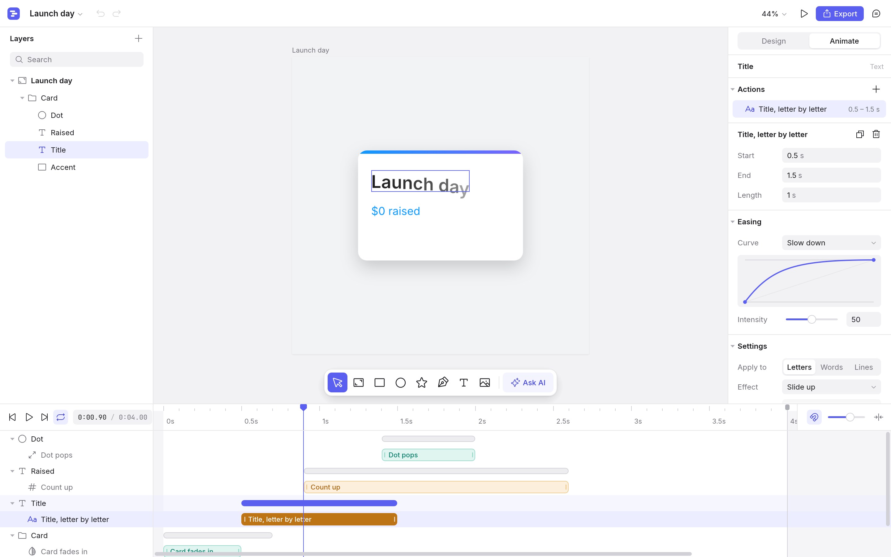

# Moshionly

**Open-source motion design for the desktop.** Animate with simple actions instead of keyframes, bring your designs in from Figma, export video, GIF and Lottie, and let the AI you already pay for work in the same file as you.

Moshionly is a native app written in Rust. It runs on macOS first, with Linux and Windows to follow. Your projects are files on your own disk.

> **Status: early, and usable end to end.** You can design and animate in the editor, play it back, export video, GIF, PNG and Lottie, chat with the AI you choose, let outside agents work in the open file, and bring designs in from Figma. It is young software: expect rough edges, and keep copies of work that matters. See [the roadmap](#roadmap) for what works today and what is next.



## Why another motion tool

Most animation software asks you to think in keyframes and curves. That is powerful, and it is also why a ten-second product animation can take an afternoon.

Moshionly works the other way round:

1. **Design the scene** the way it should look at rest.
2. **Add actions** to layers: fade in, slide, scale, move, change colour. Each action has a start, an end and an easing.
3. **Play.** The design is the resting state and the actions play on top of it.

There is nothing to keyframe and nothing breaks when you change the design later. Because every animation is a small, readable object, an AI agent can read your file, add or adjust animations, look at a rendered frame, and hand the result back fully editable.

## What it is built to do

- **Canvas and layers**: artboards, rectangles, ellipses, stars, pen paths, text, images, groups and masks.
- **Styling**: solid and gradient fills, strokes, corner radius, shadow, blur, blend modes.
- **Actions**: move, scale, rotate, opacity, resize, colour and more, plus ready-made presets (fade, slide, grow, shrink, spin, blur, reveal) and text animations by letter, word or line.
- **Easing with one slider**: smooth, natural, slow down, accelerate, overshoot, elastic, bounce, or your own curve.
- **Timeline** where each row is an action you can drag and stretch.
- **Export** to MP4, GIF, PNG sequence, transparent video and Lottie.
- **Figma import** through a plugin that keeps layers editable and lets you re-import a changed design without losing its animations.
- **AI chat with the provider you choose**: use a subscription you already have through its command-line agent (Claude Code and others), or an API key for Anthropic, OpenAI or any OpenAI-compatible endpoint, including local models.
- **Agent-ready**: a built-in MCP server gives any agent the same tools the built-in chat uses: read the file, apply edits atomically, take a screenshot, export.

## Getting started

You need [Rust](https://rustup.rs) (stable). On macOS you also need the Xcode command line tools (`xcode-select --install`).

```bash
git clone https://github.com/steshio/moshionly.git
cd moshionly
cargo run --release
```

The first build downloads and compiles dependencies and takes a few minutes. Later builds are fast. This opens the editor with a new, empty project. To open the demo project instead:

```bash
cargo run --release -- crates/moshionly-core/examples/demo.moshi
```

In the editor:

- **Design** in the Design tab: draw shapes and text, style them in the inspector, arrange layers.
- **Animate** in the Animate tab (press M): pick a layer, choose "Add action", then drag its bar on the timeline. Space plays.
- **Export** with the Export button or ⌘E: PNG, PNG sequence, GIF, MP4, WebM, ProRes or Lottie.
- **Chat** with the chat button in the top bar. Its settings let you pick a subscription you already have (Claude Code and other command-line agents) or an API key.
- **Connect an agent** with the agents button in the top bar. It shows the exact setup for Claude Code, Cursor, VS Code and other MCP clients, which then work in the open file while you watch, and every change they make can be undone.
- **Bring a design in from Figma** with the plugin, loaded in Figma's desktop app as [plugins/figma/README.md](plugins/figma/README.md) explains. A design sent from Figma, or pasted after the plugin's Copy button, waits for you to accept it.

The same `moshionly` command also works without a window:

```bash
# Export an artboard (the format comes from the file extension, or --format)
cargo run --release -- export crates/moshionly-core/examples/demo.moshi --out demo.mp4

# Serve a file to an agent over MCP on standard input and output
cargo run --release -- mcp --save crates/moshionly-core/examples/demo.moshi
```

`moshionly --help`, `moshionly export --help` and `moshionly mcp --help` list every option.

Optional: install [ffmpeg](https://ffmpeg.org) (`brew install ffmpeg`) to unlock ProRes and WebM export.

## How the project is organised

```
crates/
  moshionly-core     document model, edits, undo, easing, evaluation at a time
  moshionly-render   draws a scene with Skia
  moshionly-export   PNG, GIF, video, Lottie
  moshionly-agent    tools for AI agents and the MCP server
  moshionly-ai       chat providers: subscriptions and API keys
  moshionly-app      the desktop editor
plugins/figma        the Figma plugin
docs/                architecture and file format
```

Read [docs/architecture.md](docs/architecture.md) for how the pieces fit and [docs/file-format.md](docs/file-format.md) for the `.moshi` file format. The short version: a document is a flat list of layers and actions, a frame is a pure function of the document and a time, and every change is one of three edits.

## Make it yours

Moshionly is MIT licensed. Fork it, rename it, change the look, add your own actions and exporters, build a product on it.

- The whole look lives in one theme module in `moshionly-app`.
- A new action is one type in `moshionly-core` plus its evaluation rule.
- A new export format is one module in `moshionly-export`.
- A new AI provider is one file in `moshionly-ai`.

## Roadmap

Done:

- [x] Document model, edits, undo, the `.moshi` file format
- [x] Animation engine: actions, presets, easing, text animation, counters
- [x] AI providers: Claude Code, Cursor Agent, Codex and Gemini command-line agents, the Anthropic API and any OpenAI-compatible API
- [x] Editor window: theme, controls, canvas with pan and zoom, timeline, command palette
- [x] Skia renderer: shapes, gradients, strokes, masks, shadows, blur, images, text with bundled Inter
- [x] Agent tools and MCP server, and the endpoint the Figma plugin sends to
- [x] Figma plugin and re-import (tested against sample designs; not yet run inside Figma)
- [x] The editor on real files: open, save, layers, canvas editing, Design inspector, undo
- [x] Animate tab, editable timeline and playback
- [x] Export: PNG, PNG sequence, GIF, MP4, WebM and ProRes (with ffmpeg), and Lottie
- [x] Chat panel and AI settings in the editor
- [x] Connect an agent to the open file, accept designs from Figma, and the `moshionly export` and `moshionly mcp` commands

Next:

- [ ] Run the Figma plugin inside Figma and polish the round trip
- [ ] Packaged macOS app (signed download)
- [ ] Components, video and audio layers, shader effects
- [ ] Linux and Windows builds

## Contributing

Issues and pull requests are welcome. Start with [CONTRIBUTING.md](CONTRIBUTING.md).

## License

[MIT](LICENSE)
